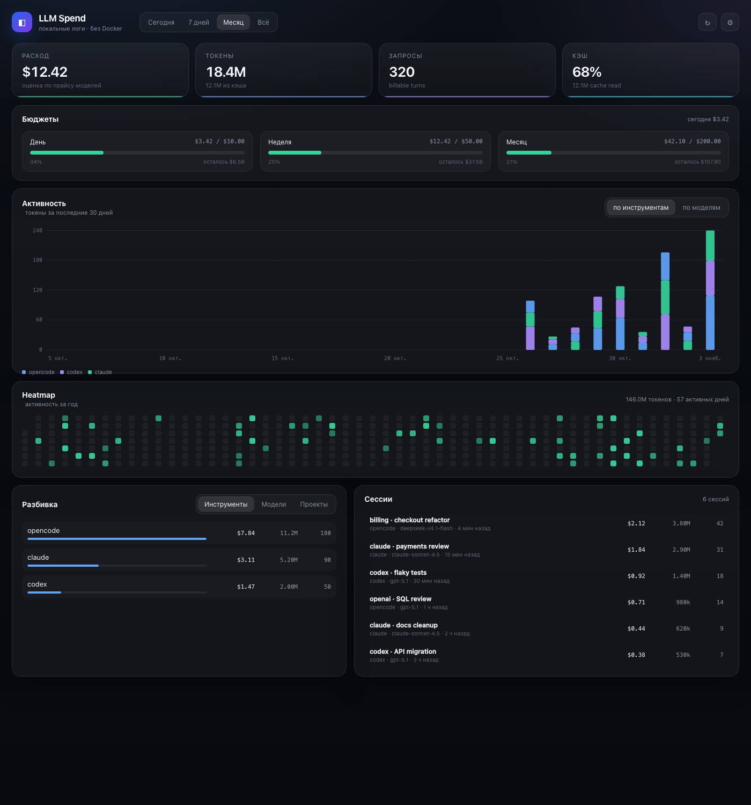

# LLM Spend Bar

[](https://github.com/Mistxs/llm-spend-bar/actions/workflows/build.yml)


Нативное macOS-приложение для аудита расходов на LLM: читает локальные логи агентов, считает токены и стоимость, показывает бюджеты в строке меню и красивый дашборд. **Без Electron, без Docker, без облака.**

Готовая universal-сборка: [Releases](https://github.com/Mistxs/llm-spend-bar/releases/latest).



```
OpenCode DB ─────┐
Claude Code JSONL ─┼──▶ LSBCollector ──▶ usage.sqlite + events.jsonl ──▶ менюбар + дашборд
Codex JSONL ─────┘
```

## Что умеет

- **Все локальные агенты, которые есть на диске**: OpenCode, Claude Code, Codex. Парсеры расширяются.
- **Токены и деньги**: input/output/reasoning/cache-read/cache-write, стоимость по прайсу модели.
- **Сессии, проекты, задачи**: видно, какой диалог и какой проект сколько съели.
- **Бюджеты**: день / неделя / месяц. Полоски в меню и на дашборде, цветовые пороги 50 % / 80 %.
- **Быстрый доступ**: менюбар с сегодня/неделя/месяц, топ-сессиями, инструментами, моделями и проектами.
- **Аналитика**: график активности, heatmap за год, разбивка по инструментам/моделям/проектам, список сессий.
- **Локальные логи**: `usage.sqlite` для запросов + `events.jsonl` append-only для аудита.
- **Свои цены**: встроенный прайс-лист + override в `pricing.json`.
- **Без сети**: приложение не отправляет данные наружу. Тексты диалогов не сохраняются: парсер берёт только токены, модель, стоимость и метаданные.

## Быстрый старт

Нужны macOS 13+ и Command Line Tools (`xcode-select --install`). Docker не нужен.

```bash
git clone https://github.com/Mistxs/llm-spend-bar.git
cd llm-spend-bar
cd llm-spend-bar
./build.sh --install
```

Приложение появится в `~/Applications` и сразу начнёт сканировать:

- `~/.local/share/opencode/opencode.db`
- `~/.claude/projects/**/*.jsonl`
- `~/.codex/sessions/**/*.jsonl`

Если каких-то путей нет — это нормально, приложение просто пропустит источник.

Клик по иконке в строке меню → **Открыть дашборд…** (⌘D).

## Поддерживаемые источники

| Источник | Путь | Что читаем |
|---|---|---|
| OpenCode 2.x | `~/.local/share/opencode/opencode.db` | `session_v2`, `session_message`: токены, модель, стоимость, title, project |
| Claude Code | `~/.claude/projects/**/*.jsonl` | assistant-сообщения: `message.usage`, модель, cwd, sessionId |
| Codex CLI | `~/.codex/sessions/**/*.jsonl` | `session_meta`, `turn_context`, `token_count`: токены, модель, cwd |

Пути можно переопределить в **Настройках** приложения или переменными окружения:

```bash
OPENCODE_DB=... CLAUDE_PROJECTS_DIR=... CODEX_SESSIONS_DIR=... ./build.sh --scan
```

Добавить новый парсер можно в `Sources/LSBCollector.m` — collectors возвращают нормализованные `LSBLocalEvent`.

## Как считается стоимость

Встроенный `Resources/pricing.json` — это прайс-лист LiteLLM (MIT) на 4500+ моделей. Для каждой модели берутся:

- `input_cost_per_token`
- `output_cost_per_token`
- `cache_read_input_token_cost`
- `cache_creation_input_token_cost`
- `output_cost_per_reasoning_token` (или output rate)

Свои цены можно положить в:

```
~/Library/Application Support/LLM Spend Bar/pricing.json
```

Формат — либо LiteLLM keys, либо короткие имена:

```json
{
  "models": {
    "my-model": {
      "input": 0.000001,
      "output": 0.000002,
      "cache_read": 0.0000001
    }
  }
}
```

Если модели нет в прайсе, стоимость = 0, а модель попадёт в блок **«Модели без цены»** на дашборде.

> Для подписок (OpenCode Go, Claude Max, Codex, Cursor) стоимость — это **оценка API-эквивалента**, а не реальный счёт. Реальный расход подписки фиксированный; приложение показывает, сколько токенов вы сожгли и сколько это стоило бы по API.

### Подписки и «окупаемость»

В настройках можно указать месячную стоимость подписки для OpenCode Go, Claude и Codex. Дашборд считает:

```
API-эквивалент за месяц / стоимость подписки = доля окупаемости
```

Например, для OpenCode Go `$3.48 / $60.00 = 6%`. Это не значит, что подписка «плохая»: она даёт фиксированный доступ к моделям, а не оплату по токенам. Но видно, сколько API-денег вы бы потратили без неё.

### Откуда цены для OpenCode Go

OpenCode в режиме подписки пишет `cost = 0` в `session_message`. Приложение видит `cost = 0` и считает оценку по прайсу LiteLLM:

| Модель | input / 1M | output / 1M | cache read / 1M |
|---|---:|---:|---:|
| `opencode_go/deepseek-v4.1-flash` | $0.30 | $1.20 | $0.006 |
| `opencode_go/deepseek-v4-pro` | $1.32 | $3.96 | $0.044 |

Это **не тариф OpenCode Go**, а API-эквивалент по публичному прайсу модели. Если OpenCode когда-нибудь запишет реальный `cost > 0`, приложение возьмёт его и пометит событие как `actual`. Если модели нет в прайсе — стоимость `$0` и она попадёт в блок «Модели без цены».

## Менюбар

- **Три полоски** — расход к бюджету за день / неделю / месяц.
- **Доллары за сегодня** — сумма за день.
- **Токены за сегодня** — суммарные токены.
- Подменю: сессии, инструменты, модели, проекты.
- **Открыть дашборд…** ⌘D, **Сканировать сейчас** ⌘R, **Настройки…** ⌘,.

## Дашборд

- KPI: расход, токены, запросы, доля cache read.
- Бюджеты: день / неделя / месяц.
- Активность: stacked bars за 30 дней, по инструментам или моделям.
- Heatmap за год.
- Разбивка: инструменты / модели / проекты.
- Сессии: title, инструмент, модель, токены, стоимость, последняя активность.
- Настройки: бюджеты, интервал сканирования.

## Данные

```
~/Library/Application Support/LLM Spend Bar/
├── usage.sqlite       # события, сессии, агрегаты (SQLite)
├── events.jsonl       # append-only лог событий (JSON Lines)
└── pricing.json       # опциональные override-цены
```

Удалить историю: закрыть приложение и удалить папку. Она будет создана заново.

## Сборка и отладка

```bash
./build.sh                     # собрать под текущую архитектуру
UNIVERSAL=1 ./build.sh         # universal: Intel + Apple Silicon
./build.sh --run               # запустить
./build.sh --install           # установить в ~/Applications
./build.sh --dashboard         # открыть сразу дашборд
./build.sh --settings          # открыть настройки
./build.sh --scan              # сканировать и напечатать сводку
./build.sh --dashboard-json /tmp/snapshot.json
python3 -m unittest tests.test_local_scan -v   # интеграционный тест локальных парсеров
```

`--scan` печатает:

```
scan: found=675 written=675 warnings=0

LLM Spend — локальные логи
Сегодня      $1.22         92M tok     363 запросов
Неделя      $2.11        121M tok     675 запросов
Месяц       $2.11        121M tok     675 запросов

Инструменты сегодня:
  opencode                      $1.22         92M tok     363
...
```

## Автозапуск

Меню → **Запускать при входе**. Приложение должно лежать в `~/Applications` или `/Applications` (используйте `./build.sh --install`).

## Ограничения

- Читаются только инструменты, которые оставляют локальные логи. Cursor/Copilot/Gemini CLI можно добавить отдельными парсерами.
- Провайдерские окна лимитов (5h/week) пока не запрашиваются — бюджеты задаются вручную.
- Это аудит и визуализация, а не жёсткая блокировка. Для API-ключей жёсткие лимиты можно сделать через LiteLLM (опционально, см. ниже).
- Тексты диалогов, промпты и ответы не читаются и не сохраняются.

## Что можно добавить дальше

- Парсеры Cursor, Copilot, Gemini CLI (сейчас OpenCode + Claude Code + Codex).
- Окна лимитов провайдеров (Claude 5h/week, Codex, Cursor, Copilot).
- Уведомления при переходе через 80 % / 100 % бюджета.
- Экспорт в Prometheus/Grafana.
- Жёсткие бюджеты на API-ключи через LiteLLM (опциональный слой).

## Опционально: LiteLLM и Token Monitor

В репозитории остался старый слой для API-трафика:

- `docker-compose.yml`, `litellm/`, `bridge/` — LiteLLM-прокси и bridge в Token Monitor;
- `docs/token-monitor.md` — как собрать все источники (включая Token Monitor) в один дашборд.

Это **не требуется** для нативного приложения. Используйте, только если нужен API-прокси, жёсткие бюджеты на ключи или интеграция с Token Monitor.

## Лицензия

MIT. См. [LICENSE](LICENSE).

Прайс-лист `Resources/pricing.json` — из [BerriAI/litellm](https://github.com/BerriAI/litellm) (MIT).
